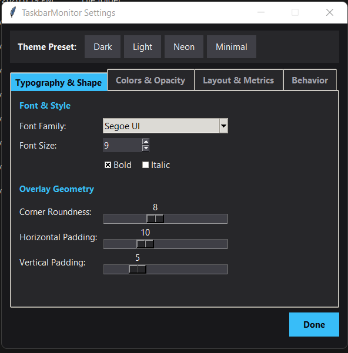

# TaskbarMonitor

A lightweight, borderless system monitor that sits on your Windows 11 taskbar and shows **live upload speed, download speed, CPU and RAM usage**, fully customizable and no installer required.

<!-- Add a screenshot at docs/screenshot.png, then uncomment: -->
<!--  -->

## Features

- Real-time **upload / download speed**, **CPU %** and **RAM %**
- Always-on-top, draggable overlay that stays above the taskbar
- Four theme presets: **Dark, Light, Neon, Minimal**
- Customize font, size, colors, opacity, corner radius, padding and spacing
- Horizontal (taskbar strip) or vertical (stacked) layout
- Choose which metrics to show; labeled or compact display; symbols (↑ ↓) or text labels
- Adjustable refresh interval, position lock, one-click position reset
- Optional **Start with Windows**
- Settings persist in `%APPDATA%\TaskbarMonitor\settings.json`
- Portable: a single `.exe`, no installation

## Download

Grab the latest `TaskbarMonitor.exe` from the [**Releases**](../../releases) page and run it. That's it.

> **Windows SmartScreen note:** the executable is not code-signed, so Windows may show an "unknown publisher" warning. Click **More info → Run anyway**, or build it yourself from source (below) and verify it against the code in this repository.

## Usage

- **Drag** the widget to place it over your taskbar
- **Right-click** the widget for the menu (Settings, Lock position, Start with Windows, Exit)
- Settings changes apply live

## Run from source

Requires **Windows 10/11** and **Python 3.9+**.

```bash
git clone https://github.com/taherhakimtatiwala/TaskbarMonitor.git
cd TaskbarMonitor
pip install -r requirements.txt
python taskbar_monitor.py
```

## Build the executable

```bash
build.bat
```

or manually:

```bash
pip install -r requirements-dev.txt
pyinstaller --onefile --noconsole --name TaskbarMonitor taskbar_monitor.py
```

The output is `dist/TaskbarMonitor.exe`.

## Privacy

TaskbarMonitor runs entirely locally. It makes **no network connections** and sends no telemetry. It only reads system counters through [psutil](https://github.com/giampaolo/psutil). The only things it writes are its settings file and, if you enable it, a per-user startup entry.

## Tech stack

Python · Tkinter · psutil · ctypes (Win32 DPI and work-area APIs) · PyInstaller

## Contributing

Issues and pull requests are welcome. Please open an issue first for larger changes.

## License

[MIT](LICENSE)
